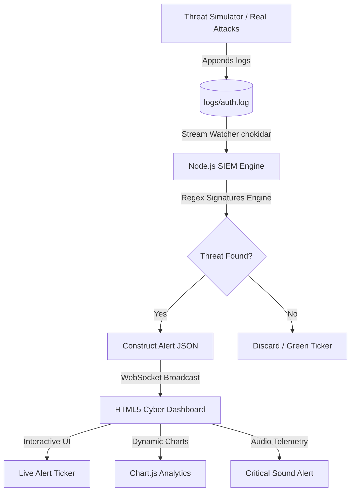

# 🛡️ Real-Time SIEM Log Parser & Alerting Console

An advanced, real-time Security Information and Event Management (SIEM) dashboard. This full-stack application features a high-performance Node.js log-parsing backend that monitors system and authorization files (`auth.log`) using regular expression heuristics to intercept attacks, actively broadcasting security logs to a responsive web dashboard via WebSockets.


---

## ⚡ Core Features

- **🔍 Active Log Tailing**: Monitors files in real-time using Chokidar's non-blocking file system events.
- **🧬 Heuristics Threat Engine**: Detects signature matches for key web and system attack vectors:
  - **SQL Injection (SQLi)**: Catches UNION queries, tautology attacks, DROP/INSERT/DELETE statements.
  - **Cross-Site Scripting (XSS)**: Flags `<script>` tags, `onerror`/`onload` triggers, SVG/IMG payloads.
  - **Path Traversal (LFI)**: Identifies `../../`, `/etc/passwd`, `win.ini`, `proc/self/environ`.
  - **SSH Brute Force**: Identifies continuous `Failed password` entries from the same remote IP.
  - **Command Injection**: Detects shell metacharacters piped to dangerous binaries.
  - **Scanner Detection**: Flags well-known tools — Nmap, sqlmap, Nikto, Hydra, and more.
- **📡 WebSocket Broadcasts**: Pushes parsed security incidents to the frontend in <10 ms.
- **📊 Premium Glassmorphic Operations Board**:
  - Animated metric counters with progress bars.
  - Live green log terminal stream (threats flash red).
  - Real-time alert feed cards with severity colour-coding.
  - Severity doughnut chart, attack frequency line chart, and top-types bar chart.
  - Filterable + searchable alert detail table.
  - Scrolling live ticker bar with latest threat summaries.
- **🔊 Telemetry Audio Alerts**: Web Audio API oscillator fires a diagnostic tone on every `CRITICAL` event (toggle on/off).
- **👾 Python Threat Simulator**: Generates realistic SSH brute-force, SQLi, XSS, path traversal, command injection, and scanner logs automatically.

---

## 🏗️ Architecture & Flow



---

## 📂 Repository Structure

```text
siem-log-parser/
├── server.js            # Node.js backend & WebSockets server
├── parser.js            # Regular expression threat analysis engine
├── log-generator.py     # Python simulator (brute-force & web attack payloads)
├── package.json         # Node.js dependencies
├── logs/
│   └── auth.log         # Watched log file (auto-created)
└── public/
    ├── index.html       # Glassmorphic dashboard interface
    ├── style.css        # Cyberpunk visual styles
    └── app.js           # WebSocket client, Chart.js, dynamic DOM
```

---

## 🚀 Quick Start Guide

### 1. Prerequisites
- Node.js v16+
- Python 3.8+ (for the simulator)

### 2. Installation

```bash
git clone https://github.com/Rizwancamp007/siem-log-parser.git
cd siem-log-parser
npm install
```

### 3. Start the SIEM Server

```bash
node server.js
```

The dashboard is live at: **http://localhost:5000**

### 4. Run the Threat Simulator

Open a **second terminal** and run:

```bash
python log-generator.py
```

Watch detections populate the dashboard in real-time!

### 5. (Optional) Watch a Real Log

Point `LOG_FILE` in `server.js` to your actual system log, e.g.:
```
/var/log/auth.log      # Linux SSH logs
/var/log/apache2/access.log  # Apache web access
```

---

## 🧬 Threat Signature Registry

```javascript
// parser.js — SIGNATURES array
const SIGNATURES = [
  { id: 'SQLi',      pattern: /(UNION\s+SELECT|SELECT\s+.+\s+FROM|DROP\s+TABLE)/i,     severity: 'CRITICAL' },
  { id: 'XSS',       pattern: /(<script[\s>]|onerror\s*=|onload\s*=|<svg\s+on)/i,      severity: 'HIGH'     },
  { id: 'LFI',       pattern: /(\.\.\/\.\.\/|etc\/passwd|win\.ini)/i,                   severity: 'HIGH'     },
  { id: 'BRUTE',     pattern: /Failed\s+password\s+for\s+.+\s+from\s+([\d.]+)/i,       severity: 'HIGH'     },
  { id: 'CMD_INJECT',pattern: /(\||;|`|\$\()\s*(ls|cat|whoami|wget|curl|bash)/i,        severity: 'CRITICAL' },
  { id: 'SCANNER',   pattern: /(Nmap|masscan|nikto|nessus|sqlmap|gobuster|hydra)/i,     severity: 'MEDIUM'   },
];
```

---

## 🌐 REST API Endpoints

| Method | Endpoint | Description |
|--------|----------|-------------|
| GET | `/` | Serves the live dashboard |
| GET | `/api/history` | Returns the last 50 alerts + stats |
| GET | `/api/stats` | Returns current metric counters |
| GET | `/api/clear` | Resets all state and truncates the log |

---

## 📄 License

This project is licensed under the MIT License — see the [LICENSE](LICENSE) file for details.
